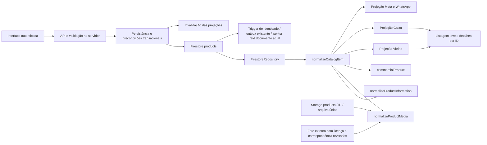

# Auditoria e padronização dos produtos — revisão local

## Estado da entrega

**Integração do [PR #14](https://github.com/edmarjunio/confloraai/pull/14):** a main recebeu `d7ddee9` e `73a98a2` enquanto a branch isolada era implementada. A simulação de integração detectou conflitos. O usuário definiu expressamente: **“Manter o escopo desta auditoria, preservando Meta e proveniência”**. A atualização foi resolvida na branch do PR, sem mesclar o PR na main. Os resultados anteriores abaixo continuam identificados por sua revisão; a validação da integração é registrada no adendo ao final. O rascunho continua necessário pelas pendências globais de paginação, conteúdo e homologação, não por uma autorização ausente sobre Meta/proveniência.

Branch `codex/contratos-produtos`, base inicial `42a573c`; diagnóstico registrado antes da implementação em `96567f9`. Contratos de mídia/conteúdo em `6e66c28`; consumidores, concorrência e leituras em `c66f0c9`. Worktree isolado; main, servidor real na porta 8080 e túnel não foram reiniciados. Sem deploy, merge do PR na main, sincronização Meta, upload, migração ou alteração comercial remota nesta entrega. A main foi incorporada somente à branch de trabalho conforme a decisão posterior do usuário.

Complemento `0ff1cc5`: upload/migração de foto também exigem a versão lida, além da referência anterior. Dois uploads simultâneos não podem substituir a galeria um do outro só porque a foto principal permaneceu igual. Storage e Firestore não formam uma transação única: um upload que conclua antes do conflito pode deixar objeto sem referência; não é excluído automaticamente e exige reconciliação/manutenção autorizada.

**Entrega incremental: contratos e consumidores implementados e testados localmente. A missão global ainda tem pendências de paginação das interfaces, revisão do conteúdo real e homologação hospedada. Não há declaração de prontidão para produção.**

O pedido anterior iniciou expressamente a sessão de testes. A continuidade executa apenas fixtures isoladas, HTTP em processo e navegador com interceptação de rede. A data não foi usada como autorização. Consultas remotas desta auditoria foram somente leitura, incluindo HEAD das imagens no bucket configurado.

## A. Mapa arquitetural e consumidores

`registered-product-content.js` concentra aliases e especificações. `product-media.js` concentra origem, licença, identidade, prioridade e galeria. `commercial-product.js` continua sendo a autoridade da interpretação comercial; não foi substituído. `normalizeCatalogItem` é uma transformação, não outra persistência.

| Caminho real | Persistência/serviço | Projeção e consumidor | Atualização/invalidação |
| --- | --- | --- | --- |
| Vitrine principal | `FirestoreRepository`, `CatalogRepository.readProducts` | `existing-store.toProduct`, `/api/storefront/catalog?projection=list`, `existing-api`, cards | Snapshot público 15 s, limitado à expiração do catálogo; geração antes/depois das mutações |
| Detalhe e informação da Vitrine | `getProductById` | `/api/storefront/products/:id`, `catalog.js` | Leitura por ID; sem cache comercial persistente de detalhes; respostas de outra rota descartadas |
| Caixa/PDV | Mesmo catálogo derivado | `toCashierProduct`, `/api/caixa/products?projection=list`, `toPdvProduct` | Carga inicial e atualização usam o mesmo adaptador; abort/generation ao mudar sessão |
| Detalhes do PDV | `getProductById` | `/api/caixa/products/:id`, `ProductInformation` | Sob demanda; só atualiza o modal/geração correspondente |
| Administração/preços/inventário | Mesmo catálogo de leitura, acesso autenticado | `/api/inventory`, imagens e conteúdo canônicos | Formulário mantém versão da abertura; `expectedUpdatedAt` rejeita edição obsoleta; galeria não reenvia campos comerciais |
| Cadastro pela Vitrine | API existente `/api/storefront/products` | Formulário carrega detalhe antes de editar | Preserva campos confirmados anteriormente; precondição da versão; upload separado |
| Importação | `ProductImportService` e `PdvRepository.transaction` | Prévia/commit existentes | IDs/importId/lotes idempotentes; não sobrescreve SKU existente; cache invalidado |
| Estoque e reservas | Serviços/transações oficiais, `products` e `stock_movements` | Inventário, pedidos, Caixa | Reserva não é editável por formulário de produto; alteração de saldo conflitada é recusada |
| Comandas/pedidos/entrega/relatórios | `orders`, núcleo comercial, `PdvRepository` e serviços existentes | Snapshots históricos dos itens | Histórico não é atualizado pelo catálogo atual; nenhuma consulta global de pedidos adicionada à listagem |
| WhatsApp/IA | Mesmo `CatalogRepository`/normalizador; serviços oficiais | Parser, busca, carrinho Meta e confirmação | Consulta comercial oficial antes de confirmar; Falar com atendente permanece humano e silencioso |
| Catálogo Meta | `products` → `functions/src/index.ts` → outbox → `MetaCatalogSyncService` | Projeção derivada, retailer ID estável | Worker relê versão atual; flags, elegibilidade, retries e reconciliação preservados; nenhuma sincronização nesta entrega |
| SaaS | `StoreRepository`, `stores/{tenantId}` | APIs próprias e leitor legado dos componentes | Isolamento preservado; não se mistura o catálogo Conflora com tenants |

## B. Matriz das fontes

| Informação | Fonte oficial | Consumidores | Duplicação encontrada | Correção/estado |
| --- | --- | --- | --- | --- |
| Identidade/SKU | `products/{id}` | Todos os canais | SKU omitido em DTOs | SKU explícito nas projeções |
| Preço/unidade/status | Firestore + `commercialProduct` | Vitrine, Caixa, WhatsApp, checkout | Conversões/filtragem divergentes | Projeções reutilizam a interpretação oficial; preço inválido não vira zero inventado |
| Físico/reservado/disponível | Firestore/transações | Inventário, Caixa, Vitrine | Nome `stock` ambíguo | `inventory.physical/reserved/available`; aliases de apresentação preservados |
| Descrição/cuidados/especificações | Campos oficiais + proveniência no produto | Todos os detalhes | Objetos descartados no Caixa e aliases por tela | Normalizador único; `{label,value,unit}`, primitivas e arrays tratados; sem apagar documentos |
| Foto/galeria/proveniência | Referências no Firestore; bytes Storage ou fonte externa legítima | Cards, detalhe, inventário, WhatsApp/Meta | Filtro de host e ordenação por consumidor | `productMedia`/`media` v1; fotos próprias prioritárias; galeria preservada |
| `product_images` | Metadados de upload, compatibilidade | Upload e proxy legado | Podia apresentar uma segunda verdade da galeria | Galeria pública agora deriva do produto, inclusive fotos externas; binários não são devolvidos |
| JSON validado | Arquivo histórico para revisão | Somente script de planejamento | 9.014 campos candidatos ausentes e 19 diferenças com campos já preenchidos | Não importado por `src`/`public`; nenhum candidato aplicado automaticamente |
| Cache/índices | Derivados do backend | Navegação e busca | Cargas completas separadas entre canais | Reuso do `CatalogRepository`; TTL e invalidação; checkout não usa a projeção |
| Clientes/permissões/financeiro | Coleções e serviços autenticados existentes | Equipe/cliente autorizado | Não migrados | Sem cópia para cache público nem alteração nesta auditoria |

## C. Auditoria dos registros reais

Snapshot de produtos e configurações em **24/10/2026 11:18:15 UTC**; sem clientes, pedidos ou pagamentos. A leitura remota de metadados confirmou Firestore **Standard**, `(default)`, `southamerica-east1`; nenhuma configuração foi alterada.

| Evidência | Resultado |
| --- | ---: |
| Registros / SKUs | 759 |
| SKUs ausentes / duplicados | 0 / 0 |
| Ativos e comercialmente visíveis | 754 |
| Inativos | 5 |
| Preços inválidos no snapshot | 0 |
| Saldo físico negativo / reservas positivas | 0 / 0 |
| Controle de estoque no snapshot | Desativado pela configuração oficial existente |
| DTO público completo, incluindo inativos compatíveis | 757 |
| Caixa ativo / inventário completo | 754 / 759 |
| Referências primárias Storage | 82 |
| Objetos Storage verificados por HEAD com imagem não vazia e HTTP 200 | 82 |
| Referências externas históricas | 677 (100 Unsplash, 577 iNaturalist) |
| Referências primárias locais nos documentos | 0 |
| Fotos com comprovação suficiente no contrato atual | 0 |
| Produtos sem mídia autorizada para publicação | 759 |
| Descrições ausentes nos documentos | 0 |
| Conteúdo sem confirmação da equipe | 759 |

Os cinco inativos são **TAXA DE ENTREGA, TROCO DO DIA, MÃO DE OBRA, RECEBIMENTO e SALDO DEVEDOR**. Troco/recebimento também são excluídos explicitamente como registros financeiros internos; por isso a API pública compatível tem 757, mas a tela e o Caixa exibem 754 ativos. Não há evidência de perda dos cinco produtos. Nenhum status foi alterado nesta auditoria.

**Storage acessível não comprova licença, origem nem correspondência com a espécie/variedade.** Não foram aprovadas as 82 imagens só por existirem no bucket. As outras 677 não foram copiadas para o Storage. Os registros históricos continuam preservados, mas não recebem autorização fictícia para exibição. A preferência anterior por foto real não autoriza um script a certificar fotos desconhecidas; a regra atual permite fontes externas legítimas com revisão explícita.

`PRODUCT_CHANNELS-before.csv` e `PRODUCT_CHANNELS-after.csv` contêm a comparação por SKU/campo/canal com hashes, sem URLs de download. Os valores completos ficam em `.private/audit/` (ignorado e não publicado). A divergência entre **projeções publicadas** passou de 1.511 campos para zero; 757 eram SKU omitido e 754 eram representações vazias diferentes de especificações (`[]`/`{}`). Isso não prova completude ou correção botânica: a fonte real não possuía especificações estruturadas e o conteúdo não revisado permanece suprimido de forma consistente. Os testes com fixtures estruturadas comprovam o caso que antes perdia informação.

Meta consultada às **11:50:49 UTC**, somente leitura: **580 vinculados, todos discontinued; 179 ausentes**. Entre vinculados, 578 retornam aprovação WhatsApp e 2 rejeição; aprovação não significa disponibilidade atual. Os dois ovos continuam rejeitados, sem mudança de nome/classificação para contornar política. A relação e motivos estão em `META-current-NAO-VINCULADOS.csv`, `META-current-INDISPONIVEIS.csv` e `META-current-REJEITADOS.csv`. Facebook/Instagram e outros catálogos não foram confirmados como vinculados. Não existe evidência de “todas as plataformas iguais”.

## D. Alterações e compatibilidade

| Arquivo(s) | Antes → alteração | Impacto/compatibilidade e evidência |
| --- | --- | --- |
| `src/catalog/product-media.js` | Política espalhada → contrato único com origem, licença, identidade, prioridade, galeria | Novo campo aditivo; leitor legado de fotos manuais preservado; testes de mídia e API |
| `src/catalog/actual-product-photo.js` | Restrição exclusiva por Storage → fachada de compatibilidade do contrato | Nomes antigos preservados para consumidores; não há duas políticas independentes |
| `src/catalog/registered-product-content.js` | Strings/aliases → atributos e especificações estruturados, unidades e seções | Sem escrita na normalização; confirmação parcial preserva dados manuais anteriores; testes cruzados |
| `src/catalog/normalize-catalog-item.js` | DTO incompleto → SKU, mídia, informações e inventário canônicos | Preço zero real preservado; inválido vira null, nunca sucesso inventado |
| `src/catalog/cashier-product-details.js` | Strings isoladas → adaptador canônico/lista leve | Mesmas unidades e informações da Vitrine; fixtures e HTTP |
| `src/catalog/catalog.repository.js` | Filtro de host duplicado/cargas por canal → índice derivado comum e `readProducts` | TTL 15 s, geração e deduplicação existentes preservados; sem autoridade de checkout |
| `src/catalog/image-migration.service.js` | Aprovação por hostname → revisão obrigatória, prova para foto local | Dry-run não promete migrar mídia não autorizada; teste do upload local explicitamente comprovado |
| `src/database/firestore.repository.js` | Merge sem precondição e exclusão colateral de foto → transação/versionamento; cursor real | Reservas protegidas, conflito de estoque rejeitado; foto antiga não apagada por edição de metadados |
| `src/storefront/existing-store.js` | Aliases repetidos → `toProduct` canônico, listagem/detalhe, cursor | Totais globais legados preservados; status grava patch; detalhe sempre lê produto atual |
| `src/storefront/public-snapshot.js` | TTL poderia somar ao índice → expiração limitada à origem | Teste de expiração e geração durante leitura |
| `src/http/app.js` | Caixa normalizava diferente → mesmas projeções e detalhe por ID | Upload grava só mídia, não preço/saldo antigo; galeria usa contrato; venda manual busca somente IDs selecionados |
| `src/http/views-admin.js` | Formulário sem revisão de licença/versão → consentimento e versão da abertura | Reordenação grava somente mídia; metadados não apagam fotos; servidor valida ADMIN |
| `src/agent/product-image.js` | Host Storage fixo → seleção canônica | HEAD apenas para Storage autorizado; não faz fetch de servidor para host externo arbitrário |
| `src/services/meta-catalog-sync.service.js` | Foto própria exclusiva → mídia licenciada revisada com atribuição | Regras comerciais, elegibilidade, outbox e bloqueios mantidos; sem sincronização real |
| `public/storefront/product-card.js` | Filtros próprios → mídia canônica prioritária | Compatibilidade de SaaS/cache antigo; lazy loading e créditos preservados |
| `public/storefront/product-info-content.js` | Aliases por tela → `productInfo` | Só apresentação; ramo legado restrito à compatibilidade |
| `public/storefront/catalog.js` | Detalhes completos na lista → consulta por ID, erro/retry e proteção de rota | Galeria interpreta strings corretamente; nenhuma foto de outro SKU como fallback |
| `public/storefront/existing-api.js` | Catálogo completo → listagem leve e deduplicação de detalhes em andamento | API legada completa continua disponível; não persiste dados privados |
| `public/storefront/app.js`, `product-entry.js` | Edição poderia partir de projeção incompleta → aguarda detalhe e envia versão | Não limpa descrição antiga porque a listagem não a carregou |
| `public/pdv/app.jsx`, `components.jsx` | Dois mappers/sem proteção de sessão → adaptador único e detalhe sob demanda | Abort/generation, erro explícito, atribuição; validação mobile/desktop |
| `src/storefront/routes.js` | `sendFile` falhava em pasta `.codex` → root explícito | Worktree oculto funciona sem alterar URLs; teste do service worker e HTML |
| `scripts/plan-product-metadata-migration.js` | Sem plano seguro → plano determinístico, sem Firebase e sem apply | Não contém preços/estoque/fotos nas propostas; revisão manual obrigatória |
| `scripts/audit-product-snapshot.js`, `report-meta-catalog.js` | Auditoria histórica → leituras verificáveis e saída separada | Sem escrita remota, logs sem URLs/tokens; relatório de bloqueios atualizado |
| `test/product-contracts.test.js`, `product-read-paths.test.js` e testes existentes ajustados | Cobertura → igualdade observável, API, concorrência, cursor e clearing | Fixtures isoladas preservadas; novos testes não entram no runtime |
| `test/helpers/audit-product-channels.js`, `docs/audit/*` | Sem matriz → snapshots privados e hashes públicos | Evidência por SKU, rotas e bytes; não é fonte de produto no runtime |

Removidos do caminho real: normalizador próprio de especificações do Caixa, aliases repetidos na transformação da Vitrine, segundo mapper de atualização do PDV, classificação de direitos por hostname, falso fatiamento paginado nas APIs que agora usam cursor e exclusão automática de imagens durante edição. Não houve remoção de documentos nem de fixtures. Os leitores legados com consumidores reais foram mantidos. `image-resolver.js` continua necessário ao importador e ao gerador histórico; não foi removido só por retornar placeholder. O JSON já estava fora do runtime na base; essa remoção não é atribuída a esta branch.

## E. Performance, estado e segurança

As medidas reproduzíveis estão em `PRODUCT_CHANNELS-after-summary.json`: bytes JSON sem compressão e duração única do HTTP **em processo com snapshot local**, sem latência de rede/Firestore/renderização. Não são p75, LCP nem medições da loja hospedada. Listagem pública leve omite detalhes/galeria secundária; detalhe acrescenta uma leitura pontual por abertura, em vez de transferir todos os detalhes em toda navegação.

| Rota na medição isolada | Bytes JSON | Tempo dessa execução |
| --- | ---: | ---: |
| Vitrine completa, compatibilidade | 1.109.560 | 137,22 ms |
| Vitrine listagem, usada pelo frontend | 902.012 | 10,24 ms (snapshot já aquecido pela consulta anterior) |
| Caixa completo, compatibilidade | 739.976 | 77,79 ms |
| Caixa listagem, usada pelo frontend | 606.168 | 80,38 ms |
| Inventário completo, compatibilidade | 3.134.562 | 57,23 ms |
| Detalhe de um produto | 1.324 | 1,37 ms |

No mesmo conjunto, a projeção de listagem reduz bytes frente à resposta completa em aproximadamente 18,7% na Vitrine e 18,1% no Caixa. Não há ganho temporal demonstrado para o Caixa nessa execução; a variação observada e a ordem dos requests não permitem causalidade ou extrapolação. As respostas de compatibilidade permanecem maiores porque mantêm consumidores antigos. Antes/depois do refactor inteiro não possui uma linha de base de latência remota válida.

- Teste instrumentado com 1.000 produtos: uma página de 24 lê no máximo **25 documentos** (lookahead), versus a varredura de 1.000; a próxima página lê outros 25. Sem loop para preencher páginas filtradas.
- Consulta real limitada a dois produtos retornou dois e `hasMore=true`; evidência em `FIRESTORE-cursor-read.json`. Não é teste de carga remoto.
- Teste dos três canais: Vitrine + inventário + Caixa compartilham **uma consulta de produtos**, antes três consultas independentes, dentro da mesma validade. Mutação confirmada invalida e provoca nova consulta. Configurações/movimentos têm leituras próprias.
- Cada gravação de produto agora revalida o documento em transação, acrescentando leitura frente ao merge simples. Isso é custo de integridade, não otimização artificial.
- Snapshot servidor 15 s, cache público cliente 60 s de frescor/24 h de retenção/4 MiB, mantendo estrutura e cards utilizáveis durante revalidação. Outros processos convergem por TTL; não se promete atualização instantânea entre instâncias.
- Nenhum histórico global de pedidos foi acrescentado à abertura do catálogo ou inventário. Venda manual passou de varredura de produtos para IDs selecionados.
- Prova/licença/ator ficam no documento oficial; projeção pública expõe somente URL, fonte e créditos necessários. Nenhum token Meta, segredo, cliente, pagamento ou permissão vai para IndexedDB público. Links públicos de imagem continuam sendo referências de mídia, não credenciais administrativas.
- URLs externas revisadas precisam de HTTPS e licença/documentação; o backend não baixa essas imagens ao resolver uma mensagem. Disponibilidade visual continua sujeita à origem e ao cliente. Não se promete durabilidade de URL externa.

**Limite ainda não resolvido:** Vitrine/PDV/administração continuam usando o índice completo para busca por substring, categorias, variantes e totais globais. O inventário completo ainda retorna documento compatível amplo (~3 MiB no snapshot). O botão visual “carregar mais” continua limitando DOM, não leituras Firestore. A API por cursor já limita leituras, mas a migração de todos esses consumidores não está concluída. Não se apresentou filtro local de uma página como busca global. A próxima etapa precisa alinhar o índice derivado de busca/facetas e cursores com todos os consumidores e testar escala; se exigir backfill, ele deve passar por revisão/autorização separada. Nenhum índice/coleção remoto foi criado nesta entrega.

## F. Revisão individual do AGENTS.md

| Regra | Esperado / local e evidência encontrada | Estado e correção/validação |
| --- | --- | --- |
| Ler contrato antes de carregamento/cache | `docs/performance/CONTRATO.md`, diagnóstico antes dos commits | Conforme; regras aplicadas, limites abaixo explícitos |
| Preservar design/permissões/fluxos | Middlewares de sessão, `commercial-order`, `PdvRepository`, layouts existentes | Parcial: regressão isolada coberta; homologação hospedada de todos os perfis pendente |
| Pix manual e API Sicredi pendente | `pix-mode`, cliente real e fixtures bancárias não substituídos | Conforme no escopo do diff; nenhuma cobrança remota; homologação financeira real pendente |
| Reset somente de projeções com geração | `cache-generation.mjs`, `public-catalog.mjs`, snapshot/invalidação | Conforme; não alterada geração nem apagado Firestore/auth/operações |
| Estrutura/essencial antes de secundário | Shell, listagem leve, import de detalhe e consulta por ID | Conforme nos cenários mobile/desktop isolados; metas de campo pendentes |
| Sem leitura global de pedidos | Catálogo/inventário usam produtos/configurações/movimentos | Conforme por inspeção e testes; nenhum novo consumidor de pedidos nesses caminhos |
| Reuso público com validade/invalidação | Catálogo 15 s, snapshot limitado à origem, cliente 60 s | Conforme em testes de geração, TTL e concorrência; convergência interinstância por TTL |
| Isolamento privado/troca de usuário | APIs no-store, sessão por aba, caches públicos whitelist | Parcial: testes isolados e abort do PDV; auditoria de todas as regras remotas Storage pendente |
| Cache não confirma operação comercial | Checkout/estoque/pagamentos usam serviços/transações oficiais | Conforme no escopo; testes de preço oficial/reservas/idempotência; não valida liquidação real |
| Lista utilizável durante revalidação | Cards preservados e cenário rede lenta | Conforme nos testes mobile/desktop; não há spinner global novo |
| Paginação reduz leituras reais | `getProductsPage`, APIs `limit/after`, teste 1.000 registros | **Parcial**: API limitada, UI/global search ainda usa índice completo; concluir migração dos consumidores |
| Streams/cleanup/respostas antigas/prefetch | Mecanismos existentes preservados; abort/generation no PDV e detalhes | Parcial: cobertura isolada de navegação/reconexão; campo/abas múltiplas reais pendentes |
| Sem dados fictícios no runtime | Guarda isInMemory somente test, busca por initialData e JSON runtime | Conforme por inspeção/grep e testes de isolamento; não se apagou conteúdo histórico sem revisão |
| Preservar fixtures fora do deploy | `test/`, `.gcloudignore`, build e hosting `public/` | Conforme por inspeção; nenhum fixture importado pelo bundle de produção |
| Manter testes e remover só sem consumidores | Adaptadores duplicados consolidados; legados ainda referenciados preservados | Conforme no diff; nenhum teste removido; inventário de consumidores no relatório |
| Explicar leituras/bytes/estado/segurança e medir autorizado | Artefatos JSON/CSV, testes instrumentados e sessão já autorizada | Parcial: resultados locais disponíveis; p75/LCP/INP/CLS e carga hospedada não medidos |
| Não publicar sem validação/autorização | Branch/worktree, PR draft, nenhuma publicação remota da aplicação | Conforme; push de branch/PR não é deploy, nenhum merge |
| Data não inicia testes automaticamente | Autorização expressa anterior para iniciar sessão, preservada neste turno | Conforme; testes isolados, sem mensagens ou efeitos financeiros reais |

Não há conformidade total declarada. Nenhuma configuração remota de regras, IAM ou índices foi modificada. O arquivo `firestore.rules` versionado nega acesso cliente direto; SDK servidor continua dependendo de IAM e validação/autorização do backend. Ausência de arquivo Storage local impede atestar regras Storage hospedadas por inspeção do repositório.

## G. Migração, homologação e rollback

Validação final local: `npm run build:frontend`, `npm run check:full`, `npm run lint` e `git diff --check`; suíte Node com **495 aprovados, zero falhas e um ignorado** (concorrência multi-instância exige emulador); Playwright de carregamento com **32 aprovados**, mobile e desktop. Os cenários incluem cache fresco, rede lenta, revalidação sem desmontar cards, checkout com preço oficial, mudança de sessão e leitura de detalhes iguais em Vitrine/Caixa. Testes unitários adicionais verificam mídia externa, preservação de fotos próprias, unidades técnicas, edição obsoleta, reserva, preço zero real, ausência de imagem, endpoints reais e limites de leitura. Logs completos em `.private/audit/`; são evidência local, não saída de produção. Erros `PROVIDER_NOT_CONFIGURED` nos cenários de encomenda são falhas explícitas do provedor propositalmente ausente da fixture; nenhum envio real foi feito.

`node scripts/plan-product-metadata-migration.js .private/audit/source-products.json` gera plano privado determinístico, sem abrir Firebase. 9.014 propostas exigem revisão humana, 19 diferenças preservam Firestore. O comando rejeita `--apply`. Não aprova texto gerado, fotos ou espécie automaticamente. Para migrar: revisar cada campo/correspondência, registrar responsável e origem, manter hash/updatedAt, usar atualização transacional apenas de campo ainda vazio e registrar aprovação; se a versão mudou, interromper aquele item. Nenhuma migração de dados foi executada ou disfarçada como limpeza.

Homologação pendente no ambiente que vier a receber a branch: login/logout/troca de perfil e aba; cadastro e edição simultânea; fotos próprias/exteriores licenciadas, troca/remoção, falha de origem; listagem/detalhe, busca/categorias/variantes e mais de 1.000 registros; venda/reserva/cancelamento/recebimento; entrega/retirada/taxas; Pix manual/comprovante e Sicredi quando liberado; encomenda com consentimento/cotação/aceite; menu/template/CTA/carrinho Meta; intervenção humana bloqueando fila/retry; webhook repetido e recuperação de rede. A aprovação de catálogo/template é da Meta e não é garantida pelo código.

Rollback local: preservar branch e commits para revisão; reverter commits desta entrega em ordem inversa em nova branch, sem reset destrutivo. Como não houve escrita remota, não existe migração de banco a desfazer nesta fase. Se a branch for publicada e receber dados depois, `productMedia`/proveniência são campos aditivos: não apagar fotos/documentos. O código antigo pode deixar de exibir fotos externas revisadas; validar esse impacto antes de rollback hospedado. Reapontar imagem não exclui objetos antigos, evitando quebrar histórico; coleta de órfãos exige plano separado.

Para testar esta revisão local: usar este worktree, dependências locais e configuração de teste isolada; build local não atualiza o servidor já aberto na main. `npm start` precisa de porta livre e ambiente explicitamente escolhido. `EADDRINUSE` significa outra instância atendendo; não a encerrar sem identificá-la. Reiniciar Node local não atualiza Cloud Run/Hosting. Identificar webhook hospedado por URL/configuração Meta, log de entrada e revisão `K_REVISION`/imagem do serviço; o commit da máquina não prova qual revisão remota recebeu o evento. Não apontar o túnel real a fixtures.

Recomendações prioritárias: concluir paginação/busca/facetas sem esconder totais, revisar as imagens e conteúdo com a equipe, homologar um conjunto pequeno de SKUs reais na Meta antes de reativar publicação ampla e medir navegação em dispositivos/rede representativos. A operação da loja não deve depender de aprovação fictícia de conteúdo ou de catálogo indisponível.

Referências oficiais consultadas: [cursores Firestore](https://firebase.google.com/docs/firestore/query-data/query-cursors), [metadados Storage](https://firebase.google.com/docs/storage/web/file-metadata). O TTL imutável das fotos usa nomes de objeto únicos; mudança de foto cria outra referência e não reutiliza o mesmo objeto com conteúdo diferente.

## Adendo — resolução da atualização concorrente da main

Base integrada: `73a98a2`, incluindo `d7ddee9`. A integração ocorre exclusivamente em `codex/contratos-produtos`; os commits da main permanecem no histórico, sem reset, force push ou publicação da aplicação.

| Grupo revisado | Decisão e motivo |
| --- | --- |
| Sincronização Meta, trigger, inbox, parser, transporte e outbox | Preservados os serviços oficiais já usados pela branch. Não foi adotada a remoção das guardas de geração/posse humana, a retomada implícita ou o caminho paralelo de envio sem essas guardas. Ausência de destinatário continua sendo falha/reconciliação, não sucesso `SENT` fictício. |
| Catálogo/mídia/conteúdo | Preservados os normalizadores compartilhados, licença e proveniência. Não foi incorporado o enriquecimento independente pelo JSON nem a aprovação implícita por URL/host. |
| Regras comerciais | Preservados preço oficial, bloqueio de itens financeiros internos, reservas transacionais, idempotência e conciliação. A revisão das diferenças da main nesses arquivos mostrou remoções dessas proteções, não uma nova regra comercial a migrar. |
| Compositor humano | Preservados takeover antes da composição, requestId e proteção persistente; não voltou a enviar texto sem reivindicação/idempotência. |
| Fixtures e testes | Preservados todos os testes isolados e a foto fixture em `test/fixtures`, independentemente da nova cópia local em `public/`. Memória e simulador permanecem exclusivos dos ambientes autorizados. |
| Cache | Preservada a geração `real-products1`, sem voltar ao namespace antigo. A integração não é um reset de cache nem migração de dados. |
| Hosting | Preservado o novo alias/target `loja` em `.firebaserc`; nenhuma configuração remota foi aplicada. O isolamento dos diretórios de teste, snapshots históricos e fotos locais no pacote de deploy permanece. |
| Interface/artefatos compatíveis | Preservadas a retirada de atalhos duplicados Loja/Sair no menu móvel do PDV e as atualizações de imagens de documentação/PDF feitas na main. O logout oficial e a navegação da topbar continuam disponíveis. |
| Fotos locais novas na main | Arquivos preservados, mas não aprovados como fotos de produto nem usados como fallback. Continuam excluídos do pacote de publicação e não são enviados para Storage automaticamente. |
| Limpeza de documentos históricos | Mantida a remoção dos relatórios antigos já substituídos pelo presente diretório de auditoria. Contratos operacionais, evidências atuais e módulos com consumidores reais foram preservados. |

Nenhuma consulta adicional em massa, envio Meta, upload, migração ou alteração financeira remota foi necessária para resolver os conflitos. A validação deve distinguir a integração do código dos estados reais consultados anteriormente: o snapshot dos 759 produtos e o relatório Meta mantêm seus horários originais.

Validação após integração: build de frontend, checagem completa de sintaxe e ESLint aprovados; **495 testes Node aprovados, zero falhas, um ignorado por depender de emulador**, em 96,38 s nesta execução; **32 testes de navegador mobile/desktop aprovados**, em 57,5 s. Esses são tempos das suítes isoladas, não tempos de carregamento do produto. Nenhum marcador de conflito permaneceu. `git diff --check` aprovado; os PDFs recebidos da main foram classificados como binários em `.gitattributes`, sem modificar seus bytes, evitando interpretação incorreta como linhas de código. Evidência resumida em `INTEGRATION-validation.json`; logs em `.private/audit/integration-*.log`.
