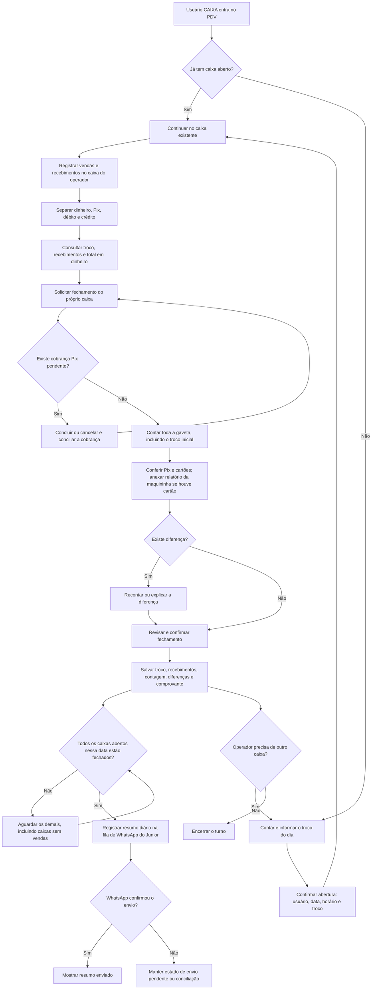

# Abertura, operação e fechamento do caixa

Cada abertura é uma sessão independente, identificada por usuário, data de abertura no fuso de São Paulo e horário. Usuários diferentes podem trabalhar simultaneamente. O mesmo usuário precisa fechar a sessão anterior antes de abrir outra, inclusive quando a sessão anterior é de outro dia.

## Valores apresentados

| Campo | Cálculo / significado |
| --- | --- |
| Troco do dia desta abertura | Dinheiro recebido para iniciar esta sessão. Zero deve ser informado explicitamente quando não houver troco. |
| Recebimentos em dinheiro | Parcelas em dinheiro efetivamente registradas nas vendas, quitações, créditos antecipados e sinais de encomendas. |
| Total em dinheiro esperado | Troco inicial + recebimentos em dinheiro. |
| Dinheiro contado | Todas as notas e moedas na gaveta, incluindo o troco inicial. |
| Diferença em dinheiro | Dinheiro contado − total em dinheiro esperado. |

Exemplo: troco de R$ 100,00 + recebimentos de R$ 350,00 = R$ 450,00 esperados na gaveta. Se o cliente entrega R$ 100,00 para uma compra de R$ 70,00 e recebe R$ 30,00 de troco, o recebimento da venda é R$ 70,00.

O troco não é venda nem faturamento. Pix e cartões permanecem separados do dinheiro físico. Fiado ainda não recebido e uso de saldo do cliente não aumentam o dinheiro da gaveta. Sinal de encomenda e pagamento do restante entram uma única vez, nas sessões em que são recebidos.

## Regras de conferência

- A abertura é obrigatória para CAIXA; o backend também bloqueia criação e recebimento sem abertura. ADMIN pode abrir uma sessão pelo relatório, mas suas operações administrativas sem sessão não fazem parte deste consolidado de sessões.
- Duas solicitações simultâneas não abrem dois caixas para o mesmo usuário.
- Um fechamento pertence à sua abertura, e não apenas ao par usuário/data. Repetir o fechamento ou tentar fechar a sessão de outro usuário é bloqueado.
- Cada novo turno começa com novo troco informado e recebimentos zerados. Os valores do turno anterior ficam preservados no histórico.
- A conferência exige valores válidos, não negativos, para dinheiro, Pix, débito e crédito. Diferenças precisam de observação; cartões exigem comprovante da própria sessão.
- Cobranças Pix vinculadas à sessão precisam estar concluídas ou canceladas antes do fechamento. Pagamento misto cancelado com valores já recebidos exige conciliação; não é descartado silenciosamente.
- A contagem de caixas inclui aberturas sem vendas. A gravação do último fechamento e a criação da mensagem ocorrem na mesma transação.
- O WhatsApp usa `JUNIOR_WHATSAPP_NUMBER`, com alternativa em `OWNER_WHATSAPP_NUMBER`. Sem destinatário ou confirmação do provedor, a interface não afirma que enviou.
- Se todos fecharem e alguém abrir outro caixa depois, o resumo anterior continua sendo um retrato daquele momento. Ao fechar todos novamente, o Junior recebe uma nova revisão consolidada. O total de trocos das aberturas é histórico: o mesmo dinheiro reutilizado em outro turno não representa nova receita.

## Validação e publicação

Os testes usam banco simulado e WhatsApp falso: não enviam mensagens reais ao Junior. A publicação e a homologação em produção são etapas separadas. Fechamentos anteriores ao controle de sessões são preservados; o novo fluxo contabiliza recebimentos a partir das novas aberturas. Recomenda-se ativar o novo fluxo antes da primeira abertura de um dia, após encerrar a operação anterior.
